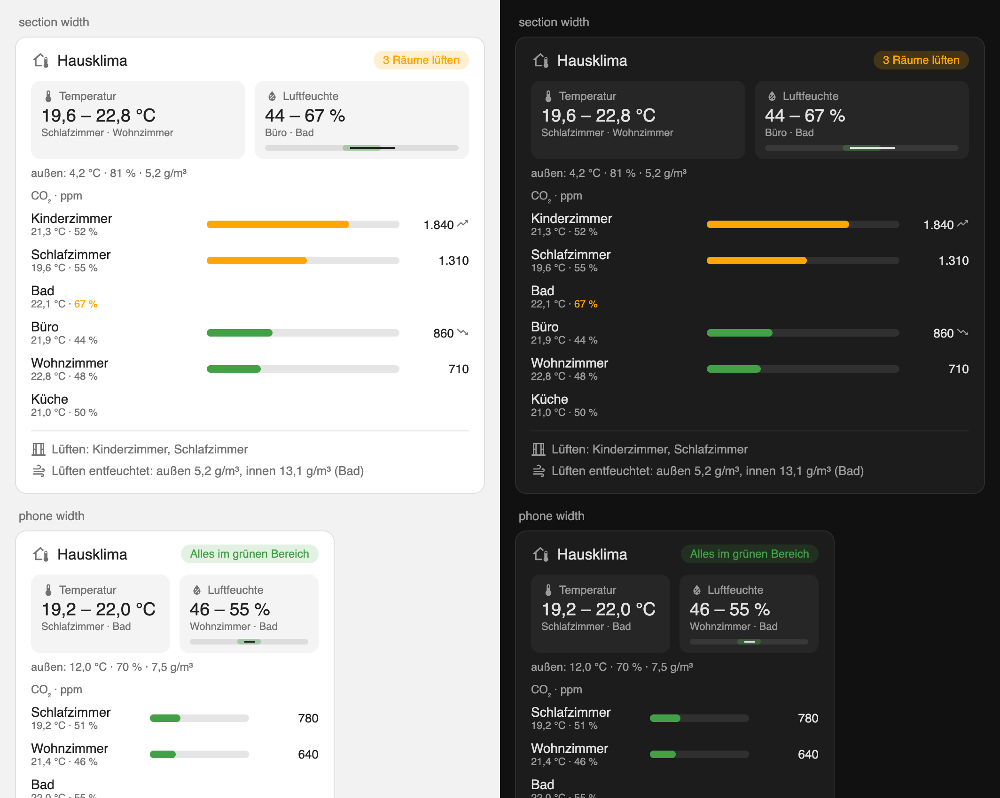

<p align="center">
  <a href="https://my.home-assistant.io/redirect/marketplace_repository/?owner=yannick80&repository=ha-house-climate-card&category=plugin">
    
  </a>
</p>
<p align="center">
  <a href="https://github.com/yannick80/ha-house-climate-card/releases/latest">
    
  </a>
  <a href="https://www.home-assistant.io">
    
  </a>
  <a href="https://github.com/yannick80/ha-house-climate-card/actions/workflows/validate.yml">
    
  </a>
  <a href="https://github.com/yannick80/ha-house-climate-card/releases">
    
  </a>
  <a href="LICENSE">
    
  </a>
</p>

# House Climate Card

A Home Assistant dashboard card that sums up the indoor climate of the whole house in one place: CO₂ per room, the range of temperatures and humidity, the outdoor values, and short hints on when opening a window actually helps.

**No configuration needed.** The card finds every temperature, humidity and CO₂ sensor through the areas you have already assigned in Home Assistant.


<!-- ha-marketplace:exclude-start -->
**Contents:**
[What you get](#what-you-get) ·
[What the card shows](#what-the-card-shows) ·
[Before you start](#before-you-start) ·
[Installation](#installation) ·
[Add the card](#add-the-card) ·
[How sensors are found](#how-sensors-are-found) ·
[Options](#options) ·
[Tips](#tips) ·
[Troubleshooting & FAQ](#troubleshooting--faq) ·
[Getting help](#getting-help) ·
[For developers](#for-developers) ·
[Credits](#credits)
<!-- ha-marketplace:exclude-end -->

## What you get

- **The whole house in one card.** It shows at a glance whether everything is fine, and if not, where.
- **Zero configuration.** Add the card and you're done. It uses your areas, not a list of entities you have to maintain. A new sensor in a room shows up on its own.
- **Knows what isn't room air.** Heating flow and return, boilers, ovens, steam ovens, coffee machines, fridges and chip temperatures are left out automatically.
- **Advice that's actually right.** The card compares *absolute* humidity inside and outside, so it knows that airing a damp bathroom on a muggy summer day makes it worse.
- **CO₂ trend.** An arrow shows whether a room's CO₂ is rising or falling, taken from the recorder history.
- **Your Home Assistant language.** The card's own texts are in English and German, and numbers follow your locale.
- **Visual editor.** Search for "House Climate" in the card picker.
- **Fits the sections dashboard.** Full row width by default, works from half width up and in the old masonry view too.
- **No other custom cards needed.** One JavaScript file, no dependencies.
- **Runs on old wall tablets** such as the Shelly Wall Display.

## What the card shows

| Part | Shows |
|---|---|
| **Status badge** | *All good*, *Air the kids' room*, *Air 3 rooms* or *Check*. The worst room sets the colour. |
| **Temperature** | The coldest and the warmest room, e.g. **19.6 – 22.8 °C**, with both rooms named below |
| **Humidity** | The driest and the most humid room, on a bar that marks the comfort band (40–60 %) |
| **Outside** | Temperature, relative and absolute humidity (g/m³) |
| **Rooms** | All rooms, or with `only_issues: true` only those that need attention. Worst first. Each room shows temperature and humidity (highlighted outside the comfort band), and a CO₂ bar with value and trend arrow if it has a CO₂ sensor. |
| **Hints** | Only when there is something to do (see below) |

CO₂ colours follow the guide values of the German Environment Agency (Umweltbundesamt):

| CO₂ | Rating | Colour |
|---|---|---|
| below 1000 ppm | fine | green |
| 1000–2000 ppm | conspicuous, air the room | orange |
| above 2000 ppm | unacceptable | red |

Hints:

| Hint | When |
|---|---|
| **Open a window:** *rooms* | CO₂ at or above 1000 ppm |
| **Airing dries the air:** outside 5.2 g/m³, inside 13.1 g/m³ (*rooms*) | A room is above 60 % and the outside air holds at least 1 g/m³ less water |
| **Airing won't dry the air right now** | A room is above 60 %, but the outside air is just as humid or more |
| **Mold risk:** *rooms* | Humidity at or above 70 % |
| **Very dry air:** *rooms* | Humidity below 30 % |

Tap a room, a tile or the outdoor line to open that sensor's history.

<details>
<summary>German interface (Deutsch)</summary>



</details>

## Before you start

- [ ] **Home Assistant 2024.12 or newer.**
- [ ] **Your sensors are assigned to areas.** Assigning the device is enough. Check under **Settings** > **Areas, labels & zones**.
- [ ] **The sensors have a device class**: `temperature`, `humidity` or `carbon_dioxide`. Almost every integration sets it. You can check under **Developer tools** > **States** (attribute `device_class`).

<!-- ha-marketplace:exclude-start -->
## Installation

### Home Assistant 2026.11 and newer (Marketplace)

**One click:** select this button, then confirm in your Home Assistant.

[](https://my.home-assistant.io/redirect/marketplace_repository/?owner=yannick80&repository=ha-house-climate-card&category=plugin)

**Or by hand:**

1. In Home Assistant, go to **Settings** > **Marketplace**.
2. In the upper-right corner, select **Add from link**.
3. Under **GitHub link**, enter `https://github.com/yannick80/ha-house-climate-card`. If Home Assistant asks for the type, choose **Dashboard**.
4. Open House Climate Card and select **Install**.
5. Reload the browser (on phones and tablets: close and reopen the app).

### Home Assistant 2026.10 and older (HACS)

[](https://my.home-assistant.io/redirect/hacs_repository/?owner=yannick80&repository=ha-house-climate-card&category=plugin)

1. Open **HACS** in the sidebar.
2. Select the three dots in the upper-right corner, then **Custom repositories**.
3. Enter `https://github.com/yannick80/ha-house-climate-card`, choose the type **Dashboard**, and select **Add**.
4. Open House Climate Card and select **Download**.
5. Reload the browser.

### Manual installation

1. Download `house-climate-card.js` from the [latest release](https://github.com/yannick80/ha-house-climate-card/releases/latest).
2. Copy it to `config/www/house-climate-card.js` (the `www` folder next to `configuration.yaml`; create it if it does not exist).
3. Go to **Settings** > **Dashboards**, select the three dots, then **Resources**.
   (No **Resources** entry? Turn on **Advanced mode** in your user profile first.)
4. Select **Add resource**, enter `/local/house-climate-card.js?v=0.2.0`, choose **JavaScript module** and select **Create**.
   Raise the `?v=` number after each update so browsers load the new file.
5. Reload the browser.
<!-- ha-marketplace:exclude-end -->

## Add the card

1. Open a dashboard, select the pencil, then **Add card**.
2. Search for **House Climate** and pick **House Climate Card**.
3. That's it. Everything in the editor is optional.

In YAML:

```yaml
type: custom:house-climate-card
```

## How sensors are found

**The sensors chosen in the area settings come first.** If you picked a temperature or humidity sensor for an area (**Settings** > **Areas, labels & zones** > edit the area), the card uses exactly that one for the area, and nothing else for that value. It is used even if it sits on a device in another area or has a name the technical filter would catch. Only `exclude_entities` overrides it. CO₂ has no such setting in Home Assistant, so it is always found as described below.

For areas without that choice, and for CO₂, the card uses every `sensor.*` entity that

- has the `device_class` `temperature`, `humidity` or `carbon_dioxide`,
- is in an area: the entity's own area, otherwise its device's area,
- is not a diagnostic sensor (so the chip temperature of a smart plug doesn't count), and is not hidden or disabled.

**Several sensors in one room:** without a sensor chosen in the area settings, the card shows their mean temperature and humidity. For CO₂ it always shows the highest value. If the mean looks wrong, choose the right sensor in the area settings.

**Technical temperature sensors** are skipped, because they don't measure room air:

- heating flow and return, boiler, buffer tank, hot water, heating circuit, solar;
- oven cavity and core, steam oven, stove, coffee machine, brewing unit, milk;
- fridge and freezer, aquarium, pool, sauna;
- set points and targets, CPU, chip, internal and battery temperatures;
- every sensor of the appliance integrations `miele_lan`, `miele` and `home_connect`.

They are recognised by their entity ID, name or translation key. Humidity and CO₂ sensors are never skipped this way. Turn it off with `auto_exclude: false`.
Anything the filter misses goes into `exclude_entities`.

**Outdoors:** areas whose name contains *Außen, Outdoor, Outside, Garten, Garden, Terrasse, Terrace, Balkon, Balcony, Patio, Hof* or *Yard* count as outdoors. They are never shown as rooms. A *Wintergarten* or *conservatory* counts as a room.
For the outdoor values, the card uses, in this order:

1. the sensors or weather entity you chose under `outdoor`,
2. the sensors in `outdoor_area`,
3. the mean of all sensors in outdoor areas,
4. the first `weather.*` entity.

## Options

All options are optional.

| Option | Default | Description |
|---|---|---|
| `title` | *Indoor climate* / *Hausklima* | Card title |
| `areas` | all areas | Only these area IDs, in this order |
| `exclude_areas` | – | Area IDs to leave out, e.g. garage, cellar, server cabinet |
| `exclude_entities` | – | Sensors to leave out that the automatic filter misses |
| `outdoor` | automatic | Outdoor sensors and/or one `weather.*` entity |
| `outdoor_area` | automatic | Use only this area's sensors as outdoor values |
| `auto_exclude` | `true` | Skip technical temperature sensors |
| `only_issues` | `false` | Only list rooms whose CO₂ or humidity is outside the limits; the others are summed up in one line ("4 more rooms are fine"). The temperature and humidity ranges still cover every room. |
| `show_trend` | `true` | CO₂ trend arrows (reads the recorder history every 5 minutes) |
| `thresholds` | see below | Change single limits |

### Thresholds

```yaml
thresholds:
  co2: [1000, 2000]       # ppm: orange from, red from
  humidity: [40, 60]      # %: comfort band
  humidity_dry: 30        # %: below = very dry
  humidity_mold: 70       # %: from here = mold risk
  dehumidify_margin: 1    # g/m³ the outside air must be drier for airing to help
  trend_minutes: 30       # trend window
  trend_ppm: 100          # change that counts as rising / falling
```

Only the values you set are changed. Everything else keeps its default.

### Choosing the outdoor sensor

With several outdoor spots (a terrace and two balconies, say), pick the one that represents the outside air best. That is usually the one in the shade:

```yaml
type: custom:house-climate-card
outdoor:
  - sensor.balcony_north_temperature
  - sensor.balcony_north_humidity
```

A `weather.*` entity in the list only fills in what the chosen sensors don't measure. For example, temperature from the balcony and humidity from the weather service:

```yaml
outdoor:
  - sensor.balcony_north_temperature
  - weather.home
```

### Full example

```yaml
type: custom:house-climate-card
title: Climate
exclude_areas:
  - garage
  - server_cabinet
exclude_entities:
  - sensor.heat_pump_flow_temperature
outdoor:
  - sensor.balcony_north_temperature
  - sensor.balcony_north_humidity
thresholds:
  co2: [800, 1400]
```

## Tips

- **Area IDs** are shown in the URL when you open an area under **Settings** > **Areas, labels & zones**. In the visual editor, you simply pick the areas.
- **A room is missing:** it has no sensor with one of the three device classes, or the sensor is in no area. See [Troubleshooting](#a-room-or-a-sensor-is-missing).
- **Two sensors in one room disagree** (one near the window, one on the radiator): choose the right one in the area settings. The card then uses only that one, and so does Home Assistant's own area card.
- **Notifications** ("air the bedroom") are a job for an automation on the CO₂ sensor, not for the card. For example, use a numeric state trigger above 1200 ppm for 10 minutes.
- **Calmer card:** `only_issues: true` lists only the rooms where CO₂ or humidity is off, so on a good day the card is just the badge, the ranges and one line.
- **Smaller card:** with `areas` you can make a second card for just one floor.

## Troubleshooting & FAQ

### "Custom element doesn't exist: house-climate-card"

The browser has not loaded the card. Reload the page, and on phones and tablets close and reopen the Home Assistant app.
After a manual install, check the resource under **Settings** > **Dashboards** > **Resources**: `/local/house-climate-card.js` as **JavaScript module**.

### "No climate sensors found in any area"

None of your temperature, humidity or CO₂ sensors is in an area. Assign the devices to areas, or check that the sensors have a `device_class` under **Developer tools** > **States**.

### A temperature or humidity doesn't match any sensor

The room has several matching sensors and no sensor chosen in the area settings, so the card shows their mean. Choose the sensor in the area settings, or put the wrong ones into `exclude_entities`.

### A room or a sensor is missing

- Is the sensor or its device in an area?
- Does it have `device_class: temperature`, `humidity` or `carbon_dioxide`?
- Is it a diagnostic sensor? Those are skipped on purpose.
- Is it a temperature sensor whose name sounds technical (e.g. contains *flow*, *target*, *intern*)? Set `auto_exclude: false` and check whether it appears. If the filter is wrong about it, please [open an issue](#getting-help).
- Is the area's name one of the outdoor names? Then its sensors are used as outdoor values.

### A sensor shows up that doesn't belong there

Put it into `exclude_entities`, or the whole area into `exclude_areas`. Both can be picked in the visual editor.

### No trend arrows

Arrows only appear when the CO₂ value changed by at least 100 ppm in the last 30 minutes. The sensor must also be recorded: it must not be excluded in the `recorder` settings. The first arrows show up a few seconds after the card loads.

### The card still shows the old version after an update

Reload the browser with the cache cleared. The browser console (F12) shows the loaded version as `house-climate-card 0.2.0`.

## Getting help

Open an [issue](https://github.com/yannick80/ha-house-climate-card/issues/new/choose). Please include:

- the card version (shown in the browser console as `house-climate-card x.y.z`),
- your Home Assistant version,
- your card YAML,
- for a sensor that is missing or wrongly picked up: its entity ID, area, integration and attributes from **Developer tools** > **States**,
- for display problems, a screenshot.

## For developers

The card is a single plain JavaScript file, `dist/house-climate-card.js`, without build step or dependencies. Edit it, copy it to `config/www/` and reload the browser with the cache disabled.

Tests need only Node.js 22:

```sh
node --test tests/*.mjs
```

The preview images in `docs/` are rendered from the real card with a mocked Home Assistant: `sh docs/render-previews.sh` (needs Google Chrome and Python 3).

See [AGENTS.md](AGENTS.md) for the rules the card follows (old WebViews, error handling, sensor discovery) and [CHANGELOG.md](CHANGELOG.md) for what changed.

**Translations** are welcome: add a language to `STRINGS` in `dist/house-climate-card.js` and open a pull request.

**Technical sensor names** that the filter misses or wrongly catches: add the keyword to `TECHNICAL_RE`, with a test for both a sensor it must catch and a room sensor it must keep.

**Releasing:** bump `VERSION` in `dist/house-climate-card.js`, move the CHANGELOG entry to the new version, then publish a GitHub release with the tag `vX.Y.Z`. The release workflow checks the version and attaches the file.

## Credits

The CO₂ limits follow the guide values of the German Environment Agency, [Umweltbundesamt (2008)](https://www.umweltbundesamt.de/system/files/medien/pdfs/kohlendioxid_2008.pdf). Absolute humidity is computed with the Magnus formula.

The icons are from [Material Design Icons](https://pictogrammers.com/library/mdi/), which ship with Home Assistant.

## Disclaimer

The card shows what your sensors report and gives general hints. It is not a measuring instrument, and it doesn't replace professional advice on mold, ventilation or health.

## License

[MIT](LICENSE)
